<div align="center">

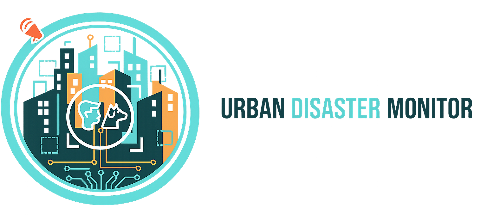<br>

[](https://docs.ultralytics.com/) [](https://github.com/roboflow/rf-detr) [](https://github.com/MariaCarolinass/urban-disaster-monitor/blob/main/LICENSE.txt)

[Dataset](./dataset) | [Modelos](./models) | [Notebooks](./notebooks/README.md) | [Kaggle](https://www.kaggle.com/datasets/mariacsoares/urban-disaster-object-detection-dataset/data) | [Roboflow](https://universe.roboflow.com/ufrnprojects-xlut9/urban-disaster-monitor) | [App](https://huggingface.co/spaces/carolinasoares/urban-disaster-monitor-v2)

Português | [English](./README.md)

</div>

# Urban Disaster Monitor

Detecção de civis, socorristas e animais em imagens e vídeos de inundações com YOLOv26 e RF-DETR.

<div align="center">

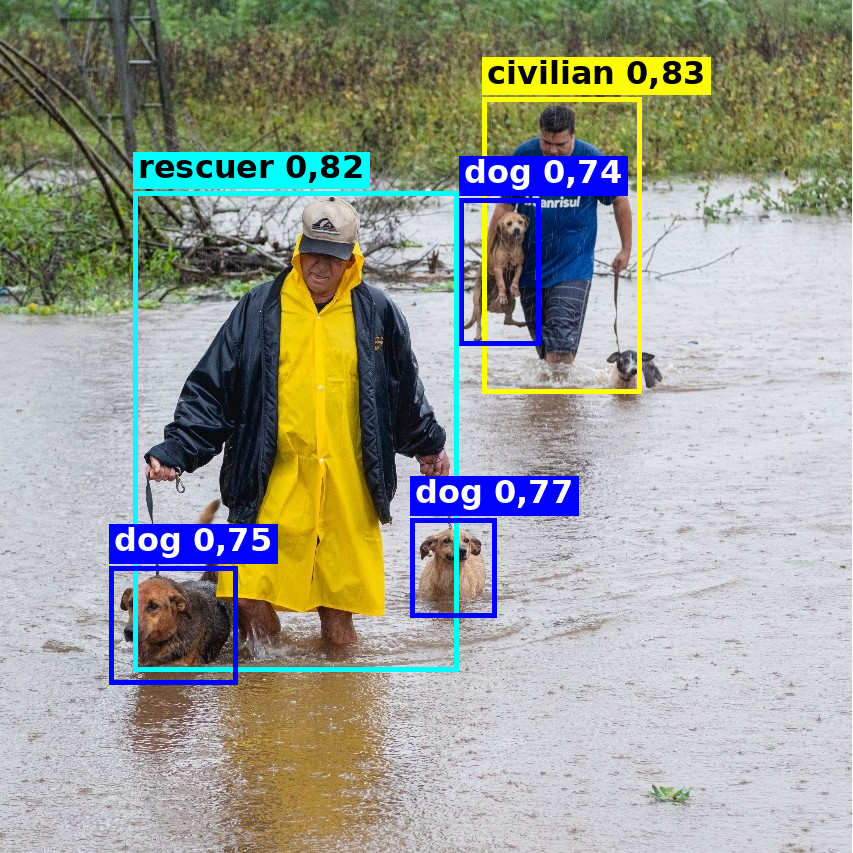<br>
<sub>Predições do YOLOv26m em uma inundação. Foto publicada pelo <a href="./static/images/README.md#sources">Jornal Gazeta Regional</a>.</sub>

</div><br>

## Estrutura de Pastas

```text
.
├── app/                     # Interface Gradio
├── dataset/                 # Imagens, anotações e créditos
├── models/                  # Pesos, históricos e resultados de comparação
│   └── comparisons/
├── notebooks/
│   ├── data-generation/
│   ├── training/
│   ├── evaluation/
│   │   ├── accuracy/
│   │   ├── performance/
│   │   └── qualitative/
│   └── video/
├── src/
│   └── evaluation/          # Código de avaliação e geração de gráficos
└── static/
    ├── images/
    │   ├── branding/
    │   ├── dataset/
    │   ├── evaluation/
    │   ├── interface/
    │   └── qualitative/
    └── video/
```

Consulte o [guia dos notebooks](./notebooks/README.md) para configurar o ambiente e o [guia de avaliação](./src/evaluation/README.md) para reproduzir os gráficos.

## Sumário

- [Sobre o projeto](#sobre-o-projeto)
  - [Funcionalidades](#funcionalidades)
  - [Contexto institucional](#contexto-institucional)
- [Dataset](#dataset)
  - [Pré-processamento e aumento de dados](#pré-processamento-e-aumento-de-dados)
  - [Composição por classe](#composição-por-classe)
  - [Por que dataset customizado?](#por-que-dataset-customizado)
  - [Aquisição de dados](#aquisição-de-dados)
    - [Imagens públicas](#imagens-públicas)
    - [Imagens sintéticas (Gemini 2.5 Flash Image)](#imagens-sintéticas-gemini-25-flash-image)
- [Anotações e modelos](#anotações-e-modelos)
  - [Classes (Roboflow)](#classes-roboflow)
  - [Arquiteturas](#arquiteturas)
  - [Fluxo de treinamento](#fluxo-de-treinamento)
  - [Ambiente de treinamento](#ambiente-de-treinamento)
- [Métricas e resultados](#métricas-e-resultados)
  - [YOLOv11 e YOLOv26](#yolov11-e-yolov26)
  - [RF-DETR e YOLOv26m](#rf-detr-e-yolov26m)
  - [YOLOv26m customizado vs. COCO no conjunto de teste](#yolov26m-customizado-vs-coco-no-conjunto-de-teste)
  - [Tempo de treinamento e inferência em CPU](#tempo-de-treinamento-e-inferência-em-cpu)
  - [Exemplos de detecção e vídeo de resgate](#exemplos-de-detecção-e-vídeo-de-resgate)
- [Conclusões e limitações](#conclusões-e-limitações)
  - [Trabalhos futuros](#trabalhos-futuros)
- [Interface Interativa](#interface-interativa)
  - [Testar online](#testar-online)
  - [Controles e limites](#controles-e-limites)
  - [Tecnologias](#tecnologias)
  - [Executar localmente](#executar-localmente)
- [Equipe](#equipe)
- [Licença](#licença)
- [Referências Bibliográficas](#referências-bibliográficas)

## Sobre o projeto

**Urban Disaster Monitor** detecta civis, socorristas, cães, gatos, cavalos e bovinos em imagens e vídeos. Os experimentos se concentram em inundações urbanas e rurais e avaliam variantes do YOLOv11, YOLOv26 e RF-DETR.

### Funcionalidades

- Detecção e classificação de **Civis**, **Socorristas**, **Vacas**, **Cavalos**, **Cachorros** e **Gatos**
- Visualização de caixas delimitadoras, rótulos e valores de confiança no app
- Consulta de métricas e comparação de modelos nos notebooks de avaliação
- Seleção entre YOLOv26 (Nano, Small, Medium e Large) e RF-DETR (Nano e Medium)

### Contexto institucional

O projeto teve início durante a disciplina de Visão Computacional ministrada pelo **Prof. Dr. [Helton Maia](https://heltonmaia.com/)** na **ECT/UFRN**. Foi desenvolvido como contribuição voluntária ao **Smart Metropolis** (IMD/UFRN) no âmbito do **Projeto SPICI (Segurança Pública Integrada em Cidades Inteligentes)**.

<a href="https://smlab.imd.ufrn.br/">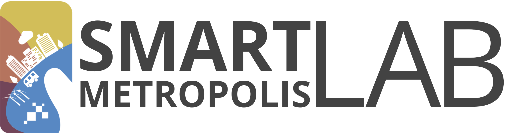</a> <a href="https://smlab.imd.ufrn.br/spici/"></a> <a href="https://imd.ufrn.br/"></a> <a href="https://www.ect.ufrn.br/"></a>

## Dataset

O conjunto reúne imagens reais e sintéticas de inundações urbanas e rurais. As **1.903 imagens originais** foram divididas em 1.337 para treino, 383 para validação e 183 para teste. Cada imagem de treino ganhou uma versão modificada, chegando a **3.240 imagens** no total. As partições de validação e teste conservam suas imagens originais.

### Pré-processamento e aumento de dados

O pré-processamento corrigiu a orientação, redimensionou as imagens para 640 × 640 px e ajustou o contraste. O aumento de dados foi aplicado apenas ao treino, com uma versão modificada por imagem original. O processo usou rotação de até ±15°, cisalhamento horizontal e vertical de até ±10°, conversão para tons de cinza em 15% das imagens, variação de saturação de até ±25% e ruído em até 0,89% dos pixels.

<div align="center">
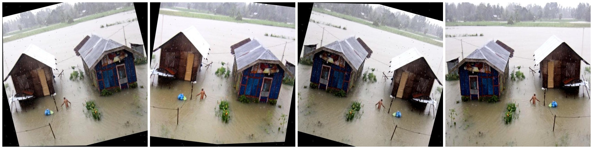
</div>

### Composição por classe

As contagens abaixo se referem ao conjunto antes do aumento de dados.

| Classe | Objetos anotados | Imagens contendo a classe |
|--------|------------------|---------------------------|
| civilian | 3.150 | 1.060 |
| rescuer | 1.074 | 397 |
| dog | 531 | 373 |
| cat | 637 | 207 |
| horse | 811 | 279 |
| cow | 749 | 180 |

Os totais de objetos correspondem às caixas delimitadoras. Uma imagem pode conter mais de uma classe. A seleção de socorristas priorizou fardas laranja ou vermelho chamativo, e a anotação exigiu indícios visuais da função. Pessoas sem indícios suficientes foram anotadas como `civilian`.

- **Anotação:** [Roboflow](https://universe.roboflow.com/ufrnprojects-xlut9/urban-disaster-monitor/)
- **Particionamento:** 82,5% treino (2.674) / 11,8% validação (383) / 5,6% teste (183)
- **Dataset particionado:** [dataset](./dataset)
- **Licença:** [CC BY 4.0](https://creativecommons.org/licenses/by/4.0/deed.en)
- **Créditos das imagens:** [Fontes e atribuição do dataset](./dataset/SOURCES.md) (13 projetos do Roboflow Universe)

### Por que dataset customizado?

O COCO usa a classe `person` para pessoas. O conjunto do projeto distingue `civilian` de `rescuer` com base nos indícios visuais disponíveis e inclui cenas de inundação com pessoas e animais parcialmente submersos.

### Aquisição de dados

Antes do aumento de dados, o treino tinha 762 imagens reais e 575 sintéticas, a validação tinha 211 reais e 172 sintéticas e o teste tinha 98 reais e 85 sintéticas. Os resultados agregam as duas origens.

#### Imagens públicas

As imagens reais vieram de repositórios públicos e de buscas. As condições de uso são específicas de cada fonte.

- [Wikimedia Commons](https://commons.wikimedia.org/)
- [Flickr](https://www.flickr.com/)
- [Google Images](https://images.google.com)
- [Roboflow Universe](https://universe.roboflow.com/)

#### Imagens sintéticas (Gemini 2.5 Flash Image)

Foram geradas **832 imagens sintéticas** com o modelo [Gemini 2.5 Flash Image](https://developers.googleblog.com/introducing-gemini-2-5-flash-image/) para reduzir desbalanceamento de classes e aumentar variabilidade contextual, especialmente em classes de animais. Os prompts seguem estilo documental/fotojornalístico, com:

- **Cenários autênticos de desastre:** ruas alagadas, campos inundados, casas submersas, animais em situações de resgate ou isolamento.
- **Diversidade de espécies:** cavalos, vacas, cachorros e gatos em diferentes contextos de inundação.
- **Variação de qualidade e resolução:** desde imagens de baixa resolução até fotos mais nítidas, simulando registros reais de campo.
- **Detalhes visuais:** proporções realistas, expressões visíveis, corpos inteiros ou parcialmente submersos, detritos, céu nublado, iluminação natural.
- **Situações variadas:** animais sozinhos, em grupos, sendo resgatados, presos em telhados, varandas, cercas ou objetos flutuantes.
- **Ambientes urbanos e rurais:** ruas, casas, pastos e fazendas afetados por enchentes.

Cada imagem foi revisada manualmente. As amostras sintéticas complementam as reais e ampliam a variabilidade intraclasse de *dog*, *cat*, *cow* e *horse*.

<div align="center">
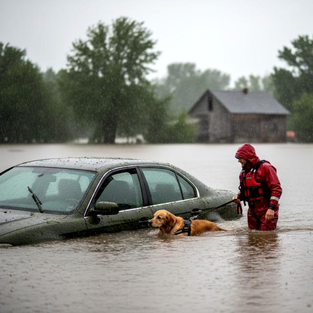<br>
<sub>Imagem sintética de inundação gerada com Gemini 2.5 Flash Image.</sub>
</div>

<details>
<summary>Exemplos de prompts</summary>

1. "Authentic documentary photo of a brown horse standing in a flooded street after heavy rain, realistic proportions, clear body visible, imperfect disaster photo"

2. "Documentary style photo of a white horse trapped in a pasture with floodwater, overcast sky, realistic proportions, authentic disaster scene"

3. "Low-resolution documentary photo of two wet cats stranded on a rooftop surrounded by floodwater, realistic proportions, visible faces, authentic urban flood event"

4. "Low quality documentary style photo of a stray dog on a small wooden raft during flood, rescue scene, realistic body intact"

5. "Documentary flood photo of cows standing in a partially submerged field, water up to their legs, cloudy sky, authentic proportions"

6. "Realistic low-resolution documentary photo of a cow isolated in floodwater reflecting sunset colors, authentic disaster photo"

</details>

[Notebook de geração de imagens sintéticas](./notebooks/data-generation/generative-images-synthetic-gemini.ipynb)

## Anotações e modelos

As anotações foram realizadas na plataforma **Roboflow**. As duas famílias de detectores usam as seis classes abaixo e foram avaliadas a cada época na validação. A comparação do YOLOv26m com os pesos pré-treinados no COCO usa o conjunto de teste. Os artefatos de cada experimento estão em [`models/`](./models).

### Classes (Roboflow)

| Classe | Descrição |
|--------|-----------|
| `civilian` | Pessoa sem indícios visuais suficientes de atuação no resgate |
| `rescuer` | Pessoa com indícios visuais de atuação no resgate |
| `cat`, `dog` | Gatos e cães |
| `cow`, `horse` | Bovinos e cavalos |

### Arquiteturas

O projeto compara duas abordagens complementares de detecção de objetos:

- **YOLOv26** (Ultralytics): detector de estágio único. Foram treinadas as variantes YOLOv26n (nano), YOLOv26s (small), YOLOv26m (medium) e YOLOv26l (large).
- **RF-DETR** (Roboflow): detector baseado em Transformer. Foram treinadas as variantes RF-DETR Nano e RF-DETR Medium, ambas com as mesmas classes do dataset.

O app baixa os pesos da variante selecionada do Hugging Face no primeiro uso e os mantém em cache local.

### Fluxo de treinamento

1. **Preparação:** exportação das anotações do Roboflow e organização das seis classes do projeto.
2. Treinar as variantes do YOLOv11, YOLOv26 e RF-DETR com suas respectivas configurações.
3. **Validação contínua:** métricas por época, curvas de perda e análise de *overfitting*.
4. Comparar as métricas de validação e os exemplos qualitativos. Usar o conjunto de teste para a comparação de cinco classes com o COCO.

### Ambiente de treinamento

O YOLOv26 foi treinado no Google Colab com uma GPU NVIDIA T4. O RF-DETR Nano usou aceleração MPS, e o Medium usou CUDA no Colab. Ambos foram configurados para 50 épocas e lote efetivo de 16 por acumulação de gradientes. As resoluções de entrada foram 384 px para Nano e 576 px para Medium.

O exemplo abaixo inicia o treino da variante Nano do YOLOv26 com os pesos oficiais pré-treinados.

```python
from ultralytics import YOLO

model = YOLO('yolo26n.pt')
model.train(
    data='dataset/data.yaml',
    epochs=50,
    imgsz=640,
    batch=16,
    name='yolov26n'
)
```

[Notebook de treinamento do YOLOv26](./notebooks/training/training-yolo-dataset.ipynb) · [Notebook de treinamento do RF-DETR](./notebooks/training/training-rfdetr-dataset.ipynb)

## Métricas e resultados

As principais comparações entre modelos usam o **conjunto de validação com seis classes**. Para cada treino, as métricas vêm da época com o maior mAP@0.5 de validação registrado. A comparação com o COCO usa o conjunto de teste e um protocolo separado de cinco classes.

- [Resultados dos modelos](./models/comparisons/)
- [Pacote de avaliação e comandos de reprodução](./src/evaluation/README.md)
- [Notebooks de avaliação](./notebooks/README.md#workflow)

### YOLOv11 e YOLOv26

| Variante | YOLOv11 mAP@0.5 | YOLOv26 mAP@0.5 | YOLOv26 mAP@0.5:0.95 | Tempo de treino do YOLOv26 |
| --- | ---: | ---: | ---: | ---: |
| Nano | 0,8606 | 0,8267 | 0,4872 | 47,6 min |
| Small | 0,8755 | 0,8667 | 0,5024 | 56,3 min |
| Medium | 0,8642 | 0,8774 | 0,5154 | 108,4 min |
| Large | 0,8621 | 0,8919 | 0,5247 | 133,1 min |

O YOLOv11 teve vantagem nas variantes Nano e Small. O YOLOv26 teve vantagem nas variantes Medium e Large, com o **YOLOv26l** registrando o maior mAP@0.5 entre os treinos da família YOLO.

<div align="center">
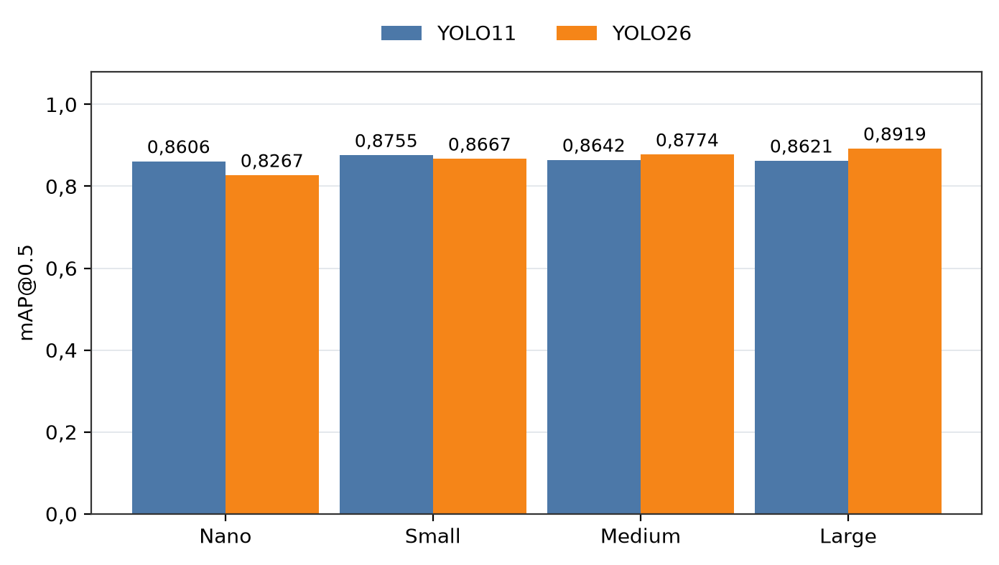
</div>

[Resultados do YOLOv26 por variante](./static/images/evaluation/yolo26-validation-map50.png) · [Curvas de validação do YOLOv11](./static/images/evaluation/yolo11-validation-curves.png) · [Curvas de validação do YOLOv26](./static/images/evaluation/yolo26-validation-curves.png)

O gráfico por classe vem da avaliação dos pesos selecionados nas 383 imagens de validação. A classe `dog` apresentou, de forma geral, o menor AP@0.5.

<div align="center">
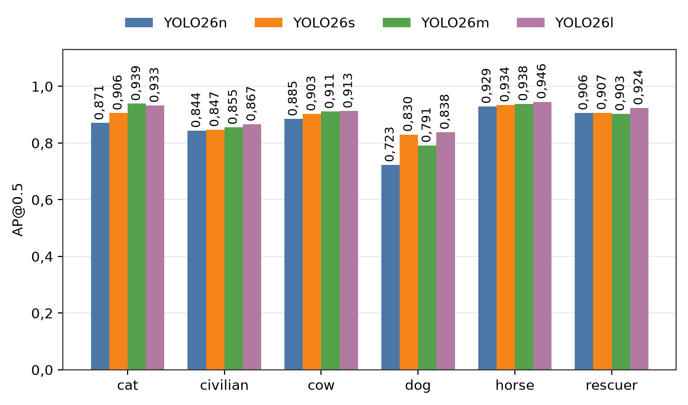
</div>

### RF-DETR e YOLOv26m

Os registros do RF-DETR preservam as métricas de validação das épocas 40 a 49. A tabela usa a época com o maior mAP@0.5 disponível para cada variante e inclui o YOLOv26m para comparação.

| Modelo | Época | Precisão | Recall | mAP@0.5 | mAP@0.5:0.95 |
| --- | ---: | ---: | ---: | ---: | ---: |
| RF-DETR Nano | 40 | 0,9115 | 0,7787 | 0,8685 | 0,5182 |
| RF-DETR Medium | 43 | 0,9159 | 0,8661 | **0,9197** | **0,5590** |
| YOLOv26m | 35 | 0,8950 | 0,7924 | 0,8774 | 0,5154 |

O RF-DETR Medium registrou o maior mAP@0.5 de validação dos experimentos. As famílias usam resoluções e implementações de avaliação diferentes, então os resultados descrevem as configurações testadas. Dentro da família RF-DETR, o F1 registrado foi 0,8366 para Nano e 0,8895 para Medium.

<div align="center">
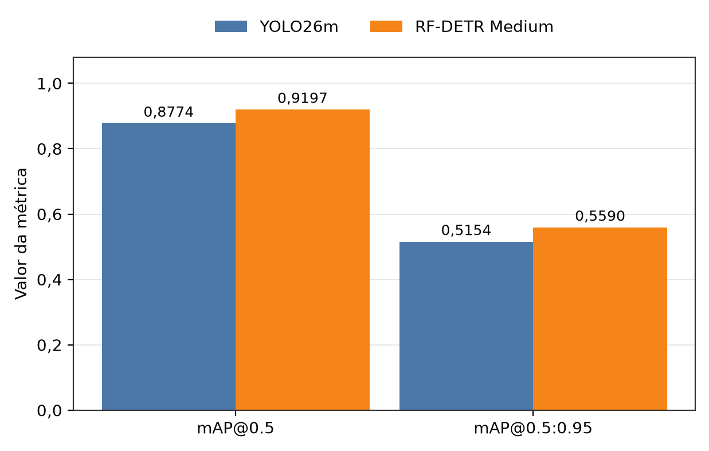
</div>

[Métricas globais do RF-DETR](./static/images/evaluation/rfdetr-validation-metrics.png) · [AP@0.5:0.95 do RF-DETR por classe](./static/images/evaluation/rfdetr-validation-ap-by-class.png) · [Curvas de validação do RF-DETR](./static/images/evaluation/rfdetr-validation-curves.png) · [Variantes Medium: precisão e recall](./static/images/evaluation/rfdetr-medium-vs-yolo26m-validation-precision-recall.png)

### YOLOv26m customizado vs. COCO no conjunto de teste

Os dois modelos foram avaliados nas mesmas **183 imagens e 702 anotações**. As cinco categorias comuns foram `person`, `cat`, `dog`, `horse` e `cow`. As anotações e predições de civis e socorristas foram agrupadas em `person` antes da supressão de não máximos compartilhada. Precisão e recall usam agregação micro, confiança de 0,25 e IoU de correspondência de 0,50.

| Métrica | YOLOv26m customizado | YOLOv26m pré-treinado no COCO |
| --- | ---: | ---: |
| Precisão micro | **0,803** | 0,765 |
| Recall micro | **0,808** | 0,718 |
| mAP@0.5 | **0,884** | 0,791 |
| mAP@0.5:0.95 | **0,542** | 0,413 |

<div align="center">
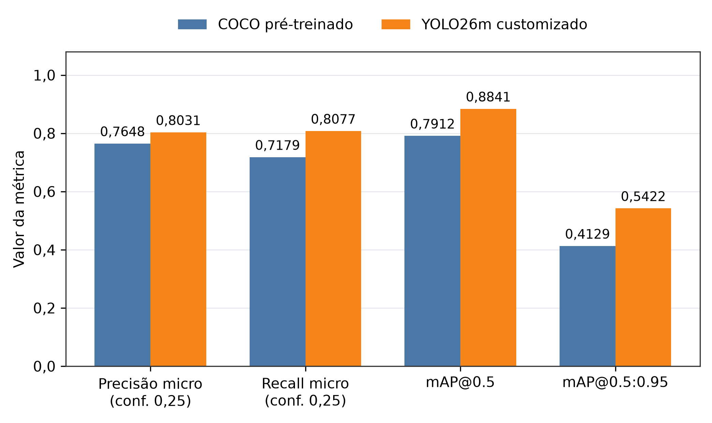
</div>

Os resultados descrevem a detecção de pessoas e animais no protocolo comum. Uma revisão posterior encontrou no treino cópias de pelo menos **14 das 183 imagens de teste** e **33 das 383 de validação**. Essa sobreposição pode elevar as métricas e favorecer o modelo customizado. [Resultados completos no teste](./models/comparisons/coco-vs-custom-yolo26m-common-test.json)

### Tempo de treinamento e inferência em CPU

Os treinos de YOLOv26 levaram **47,6–133,1 minutos** ao longo de 50 épocas. Os registros disponíveis do RF-DETR não incluem a duração do treino. A medição em CPU usou dez imagens de validação e três repetições por modelo após aquecimento. O YOLOv26n registrou a menor latência média, **73,0 ms/imagem**, enquanto o RF-DETR Medium registrou **643,8 ms/imagem**. Os tempos incluem pré-processamento, execução da rede e pós-processamento. A medição exclui carregamento de imagens e pesos, aquecimento e desenho das caixas.

<div align="center">
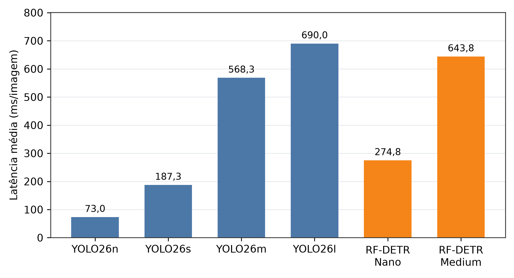
</div>

[Gráfico de duração do treino do YOLOv26](./static/images/evaluation/yolo26-training-duration.png) · [Amostras do benchmark em CPU](./models/comparisons/model-inference-times.json)

### Exemplos de detecção e vídeo de resgate

Os mosaicos mostram as mesmas quatro imagens de validação antes e depois da inferência com o YOLOv26m, usando confiança de 0,70. As caixas mostram as predições do modelo.

<div align="center">
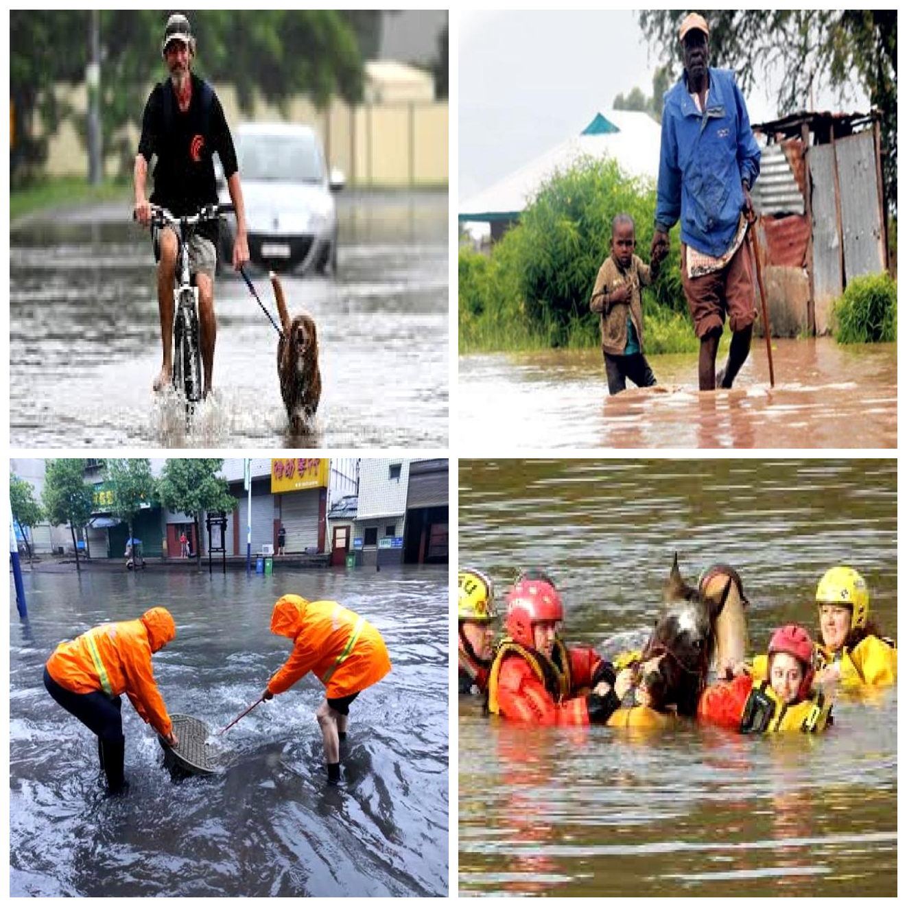
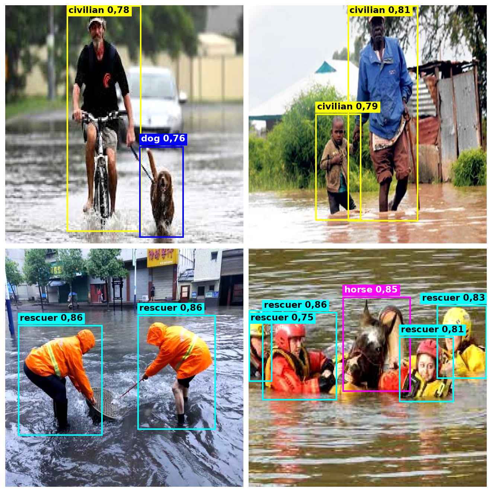
</div>

O YOLOv26m também processou uma foto externa de inundação e um vídeo de resgate com confiança de 0,25. Na primeira passagem pelo vídeo, houve detecções em **352 de 384 quadros**. A inspeção visual encontrou objetos sem caixas e rochas classificadas como animais. Os exemplos não têm anotações de referência, então essa contagem indica a frequência com que o detector produziu caixas.

<div align="center">
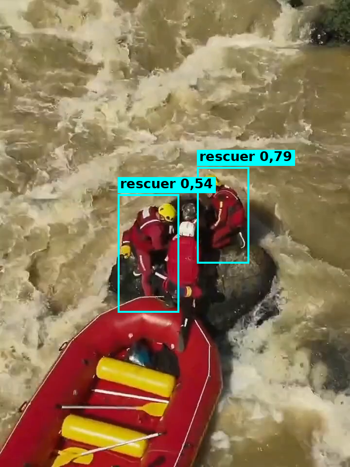
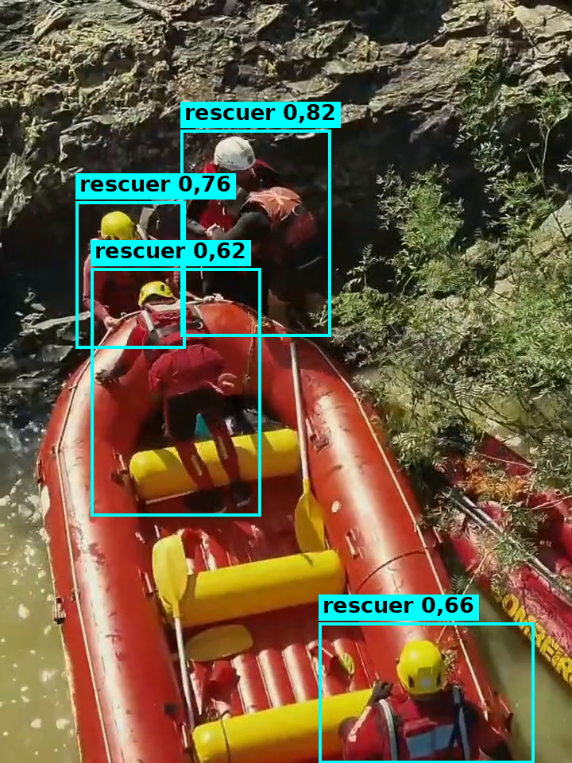
</div>

[Imagem externa original](./static/images/qualitative/external-disaster.jpg) · [Imagem externa com detecções](./static/images/qualitative/external-image-detections.png) · [Vídeo original do Corpo de Bombeiros Militar de Santa Catarina](https://www.youtube.com/shorts/6PuaEPbOhJU) · [Medições de inferência externa](./models/comparisons/external-inference.json) · [Créditos das imagens](./static/images/README.md)

## Conclusões e limitações

O RF-DETR Medium registrou o maior mAP@0.5 de validação, e o YOLOv26n teve o menor tempo médio de predição no benchmark local em CPU. A mesma validação foi usada para selecionar épocas e comparar as famílias. A presença de imagens repetidas entre partições, a mistura de imagens reais e sintéticas e a ausência de treinos repetidos limitam a generalização dos resultados.

### Trabalhos futuros

- Remover duplicatas por conteúdo visual e por imagem de origem antes de refazer as partições.
- Ampliar a diversidade de fotos reais e uniformes de socorristas e avaliar imagens reais e sintéticas separadamente.
- Repetir os treinos com sementes diferentes e medir o desempenho completo em vídeo e o consumo de memória nos dispositivos de interesse.

## Interface Interativa

A interface foi desenvolvida com **Gradio** para permitir testar os modelos treinados sem configurar ambiente de treino. É possível enviar imagens ou vídeos e visualizar as detecções (civis, socorristas e animais) com _bounding boxes_ e rótulos após o processamento.

### Testar online

A aplicação está disponível no **Hugging Face Spaces**. Não é necessário instalar nada para experimentar:

**👉 [Abrir Urban Disaster Monitor](https://huggingface.co/spaces/carolinasoares/urban-disaster-monitor-v2)**

<div align="center">
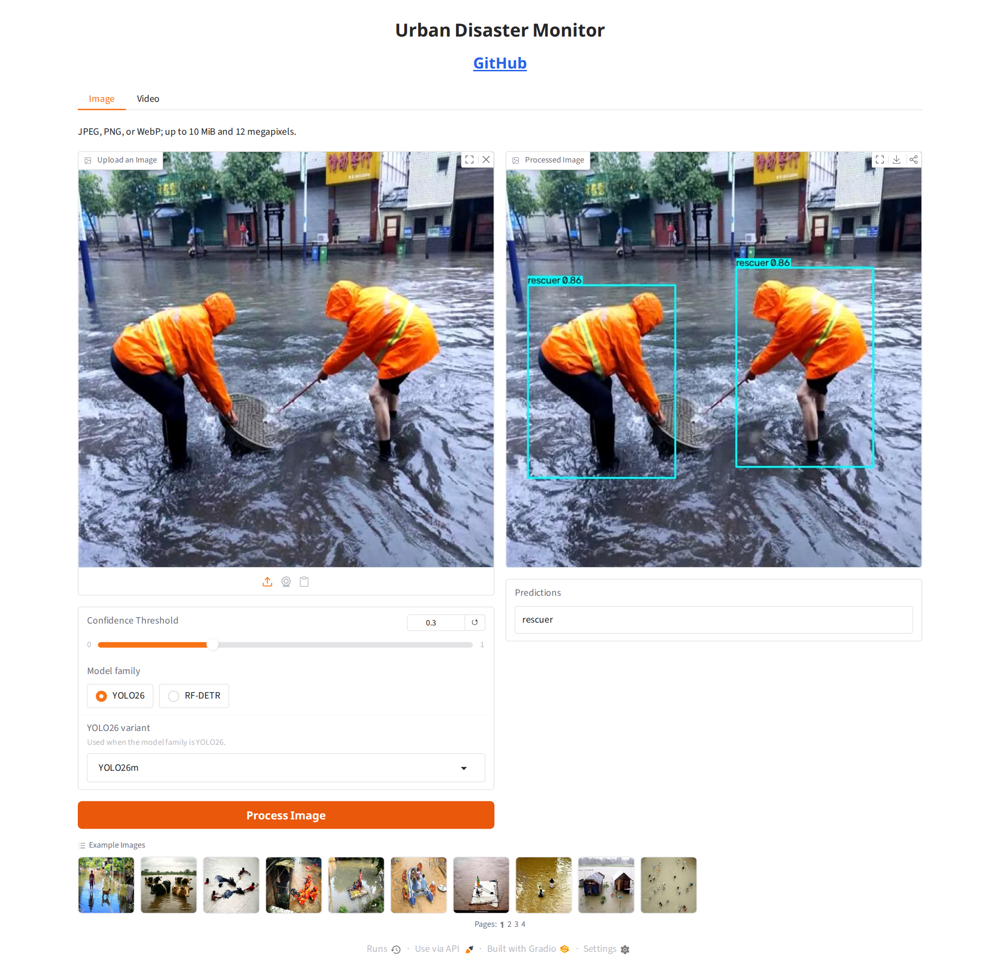
</div>

*Captura da interface local com YOLOv26m e limiar de confiança de 0,30.*

### Controles e limites

- **Família e modelo:** escolha YOLOv26 (n, s, m ou l) ou RF-DETR (Nano ou Medium)
- Aceita imagens JPEG, PNG ou WebP de até 10 MiB e 12 megapixels.
- Aceita vídeos de até 50 MiB, 60 segundos, 1280×720 px (ou 720×1280 px), 60 FPS e 1.800 quadros. Por padrão, o app processa todos os quadros. Se você escolher processar a cada dois ou três quadros, os quadros pulados aparecem no vídeo sem anotações.
- Ajuste o limiar de confiança para filtrar as detecções.
- Veja as caixas delimitadoras e os rótulos e baixe a imagem ou o vídeo processado.

### Tecnologias

[Python](https://www.python.org/) · [Gradio](https://gradio.app/) · [Ultralytics YOLO](https://docs.ultralytics.com) · [RF-DETR](https://github.com/roboflow/rf-detr) · [PyTorch](https://pytorch.org/) · [OpenCV](https://opencv.org/) · [NumPy](https://numpy.org/)

### Executar localmente

O app foi verificado com Python 3.12. É necessário acesso à internet para baixar os pesos do modelo no primeiro uso.

```bash
git clone https://github.com/MariaCarolinass/urban-disaster-monitor.git
cd urban-disaster-monitor
```

No Linux ou macOS, crie e ative o ambiente virtual.

```bash
python3 -m venv .venv
source .venv/bin/activate
```

No Windows PowerShell, use estes comandos.

```powershell
py -3.12 -m venv .venv
.venv\Scripts\Activate.ps1
```

Na raiz do repositório, instale as dependências do app e inicie a interface. Abra o endereço local exibido no terminal.

```bash
python -m pip install -r app/requirements.txt
python app/app.py
```

Para executar os experimentos, instale também as dependências descritas no [guia dos notebooks](./notebooks/README.md#local-setup).

## Equipe

| [](https://github.com/jagaldino) | [](https://github.com/MariaCarolinass) |
| :---------------------------------------------------------------------------: | :-----------------------------------------------------------------------------: |
|                           **João Galdino**                           |                             **Carolina Soares**                | 

## Licença

- O código do projeto usa a [licença MIT](./LICENSE.txt).
- O conjunto de dados publicado indica a licença [CC BY 4.0](https://creativecommons.org/licenses/by/4.0/deed.pt). Consulte os [créditos do dataset](./dataset/SOURCES.md) e das [imagens e vídeos de demonstração](./static/images/README.md).

## Referências Bibliográficas

### Modelos e avaliação

- Redmon, J., Divvala, S., Girshick, R., & Farhadi, A. (2016). [You Only Look Once: Unified, Real-Time Object Detection](https://arxiv.org/abs/1506.02640). CVPR, 779–788.
- Carion, N., et al. (2020). [End-to-End Object Detection with Transformers](https://www.ecva.net/papers/eccv_2020/papers_ECCV/html/832_ECCV_2020_paper.php). ECCV, 213–229.
- Ultralytics. (2024). [Lançamento do YOLO11 no Ultralytics v8.3.0](https://github.com/ultralytics/ultralytics/releases/tag/v8.3.0).
- Jocher, G., et al. (2026). [Ultralytics YOLO26: Unified Real-Time End-to-End Vision Models](https://arxiv.org/abs/2606.03748). arXiv:2606.03748.
- Robinson, I., Robicheaux, P., Popov, M., Ramanan, D., & Peri, N. (2026). [RF-DETR: Neural Architecture Search for Real-Time Detection Transformers](https://proceedings.iclr.cc/paper_files/paper/2026/hash/5bed8703db85ab27dc32f6a42f8fbdb6-Abstract-Conference.html). ICLR.
- Padilla, R., Passos, W. L., Dias, T. L. B., Netto, S. L., & da Silva, E. A. B. (2021). [A Comparative Analysis of Object Detection Metrics with a Companion Open-Source Toolkit](https://www.mdpi.com/2079-9292/10/3/279). *Electronics*, 10(3), 279.

### Conjuntos de dados e ferramentas

- Lin, T.-Y., et al. (2014). [Microsoft COCO: Common Objects in Context](https://link.springer.com/chapter/10.1007/978-3-319-10602-1_48). ECCV, 740–755.
- Rahnemoonfar, M., et al. (2021). [FloodNet: A High Resolution Aerial Imagery Dataset for Post Flood Scene Understanding](https://arxiv.org/abs/2012.02951). *IEEE Access*, 9, 89644–89654.
- Torralba, A., & Efros, A. A. (2011). [Unbiased Look at Dataset Bias](https://people.csail.mit.edu/torralba/research/bias/). CVPR, 1521–1528.
- UFRNProjects. [Conjunto Urban Disaster Monitor no Roboflow Universe](https://universe.roboflow.com/ufrnprojects-xlut9/urban-disaster-monitor).
- Google. (2025). [Anúncio do Gemini 2.5 Flash Image](https://developers.googleblog.com/introducing-gemini-2-5-flash-image/).

### Trabalhos sobre inundações e resposta a desastres

- Prabhu, B. V. B., Lakshmi, R., Ankitha, R., Prateeksha, M. S., & Priya, N. C. (2022). [RescueNet: YOLO-based object detection model for detection and counting of flood survivors](https://doi.org/10.1007/s40808-022-01414-6). *Modeling Earth Systems and Environment*, 8(4), 4509–4516.
- Pattankudi, M. S. Z., et al. (2025). [Human Detection in Disaster Scenarios for Enhanced Emergency Response Using YOLO11](https://www.scitepress.org/PublishedPapers/2025/136010/). INCOFT, 2, 739–746.
- Vibhuti, S. S., et al. (2025). [YOLO11: Flood Victim Detection and Rescue Alert System](https://www.scitepress.org/PublishedPapers/2025/136030/). INCOFT, 2, 804–811.
- Sai, D. H., et al. (2025). [Enhancing Emergency Response with Real-Time Video Analytics for Natural Disaster Management](https://ieeexplore.ieee.org/abstract/document/11018905). STCR.
