<div align="center">

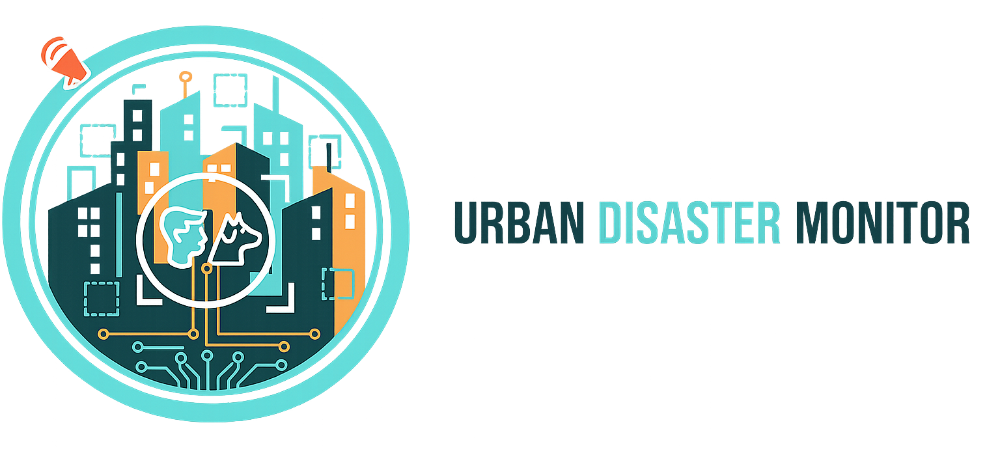<br>

[](https://docs.ultralytics.com/) [](https://github.com/roboflow/rf-detr) [](https://github.com/MariaCarolinass/urban-disaster-monitor/blob/main/LICENSE.txt)

[Dataset](./dataset) | [Models](./models) | [Notebooks](./notebooks/README.md) | [Kaggle](https://www.kaggle.com/datasets/mariacsoares/urban-disaster-object-detection-dataset/data) | [Roboflow](https://universe.roboflow.com/ufrnprojects-xlut9/urban-disaster-monitor) | [App](https://huggingface.co/spaces/carolinasoares/urban-disaster-monitor-v2)

[Português](./README-pt.md) | English

</div>

# Urban Disaster Monitor

Object detection for civilians, rescuers, and animals in flood images and videos using YOLOv26 and RF-DETR.

<div align="center">

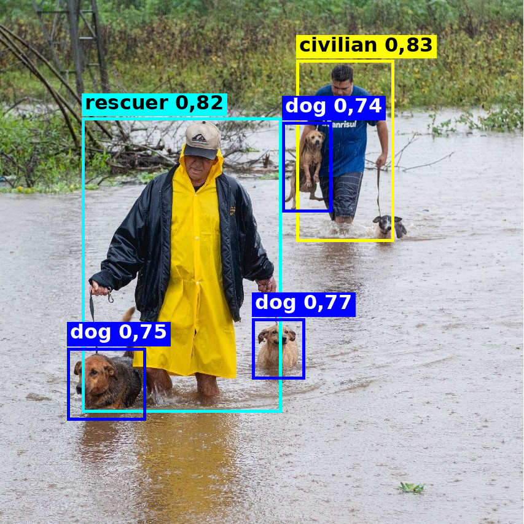<br>
<sub>YOLOv26m predictions in a flood scene. Photo published by <a href="./static/images/README.md#sources">Jornal Gazeta Regional</a>.</sub>

</div><br>

## Folder Structure

```text
.
├── app/                     # Gradio interface
├── dataset/                 # Images, annotations and attribution
├── models/                  # Checkpoints, training logs and comparison results
│   └── comparisons/
├── notebooks/
│   ├── data-generation/
│   ├── training/
│   ├── evaluation/
│   │   ├── accuracy/
│   │   ├── performance/
│   │   └── qualitative/
│   └── video/
├── src/
│   └── evaluation/          # Reusable evaluation and plotting code
└── static/
    ├── images/
    │   ├── branding/
    │   ├── dataset/
    │   ├── evaluation/
    │   ├── interface/
    │   └── qualitative/
    └── video/
```

See the [notebook guide](./notebooks/README.md) for setup and the [evaluation guide](./src/evaluation/README.md) to reproduce the charts.

## Table of Contents

- [About the project](#about-the-project)
  - [Features](#features)
  - [Institutional context](#institutional-context)
- [Dataset](#dataset)
  - [Pre-processing and augmentations](#pre-processing-and-augmentations)
  - [Class composition](#class-composition)
  - [Why a custom dataset?](#why-a-custom-dataset)
  - [Data acquisition](#data-acquisition)
    - [Public images](#public-images)
    - [Synthetic images (Gemini 2.5 Flash Image)](#synthetic-images-gemini-25-flash-image)
- [Annotations and models](#annotations-and-models)
  - [Classes (Roboflow)](#classes-roboflow)
  - [Architectures](#architectures)
  - [Training pipeline](#training-pipeline)
  - [Training environment](#training-environment)
- [Metrics and results](#metrics-and-results)
  - [YOLOv11 and YOLOv26](#yolov11-and-yolov26)
  - [RF-DETR and YOLOv26m](#rf-detr-and-yolov26m)
  - [Custom YOLOv26m vs. COCO on the test split](#custom-yolov26m-vs-coco-on-the-test-split)
  - [Training duration and CPU inference](#training-duration-and-cpu-inference)
  - [Detection examples and rescue video](#detection-examples-and-rescue-video)
- [Conclusions and limitations](#conclusions-and-limitations)
  - [Future work](#future-work)
- [Interactive Interface](#interactive-interface)
  - [Test online](#test-online)
  - [Controls and limits](#controls-and-limits)
  - [Technologies](#technologies)
  - [Run locally](#run-locally)
- [Team](#team)
- [License](#license)
- [References](#references)

## About the project

**Urban Disaster Monitor** detects civilians, rescuers, dogs, cats, horses, and cattle in images and videos. The experiments focus on urban and rural flooding and evaluate variants of YOLOv11, YOLOv26, and RF-DETR.

### Features

- Detection and classification of **Civilians**, **Rescuers**, **Cows**, **Horses**, **Dogs** and **Cats**
- Bounding boxes, class labels, and confidence scores in the Gradio app
- Model metrics and comparisons in the evaluation notebooks
- Selection between YOLOv26 (Nano, Small, Medium and Large) and RF-DETR (Nano and Medium)

### Institutional context

The project started during the Computer Vision course taught by **Prof. Dr. [Helton Maia](https://heltonmaia.com/)** at **ECT/UFRN**. It was developed as a volunteer contribution to **Smart Metropolis** (IMD/UFRN) as part of **SPICI (Integrated Public Safety in Smart Cities)**.

<a href="https://smlab.imd.ufrn.br/">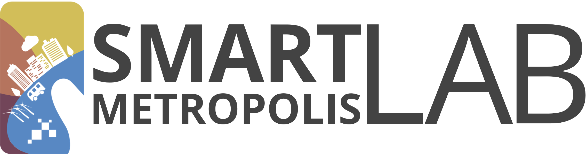</a> <a href="https://smlab.imd.ufrn.br/spici/en/"></a> <a href="https://imd.ufrn.br/"></a> <a href="https://www.ect.ufrn.br/"></a>

## Dataset

The dataset combines real and synthetic images of urban and rural flooding. The **1,903 original images** were split into 1,337 for training, 383 for validation, and 183 for testing. Each training image received one augmented copy, bringing the total to **3,240 images**. The validation and test splits retain their original images.

### Pre-processing and augmentations

Preprocessing corrected orientation, resized images to 640 × 640 px, and adjusted contrast. Augmentation was applied only to training images, with one modified copy per original. The process used rotations of up to ±15°, horizontal and vertical shear of up to ±10°, grayscale conversion for 15% of images, saturation adjustments of up to ±25%, and noise on up to 0.89% of pixels.

<div align="center">
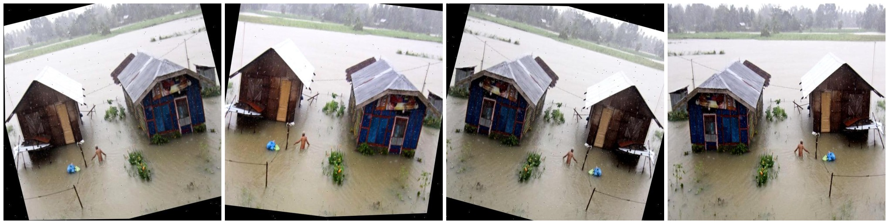
</div>

### Class composition

Counts refer to the dataset before augmentation.

| Class | Annotated objects | Images containing the class |
|--------|------------------|---------------------------|
| civilian | 3,150 | 1,060 |
| rescuer | 1,074 | 397 |
| dog | 531 | 373 |
| cat | 637 | 207 |
| horse | 811 | 279 |
| cow | 749 | 180 |

Object counts refer to bounding boxes. One image may contain several classes. The rescuer image selection prioritized bright orange or red uniforms, and the annotations relied on visible evidence of a rescue role. People without sufficient visual evidence were labeled `civilian`.

- **Annotation:** [Roboflow](https://universe.roboflow.com/ufrnprojects-xlut9/urban-disaster-monitor/)
- **Partitioning:** 82.5% train (2,674) / 11.8% validation (383) / 5.6% test (183)
- **Partitioned dataset:** [dataset](./dataset)
- **License:** [CC BY 4.0](https://creativecommons.org/licenses/by/4.0/deed.en)
- **Image-source credits:** [Dataset sources and attribution](./dataset/SOURCES.md) (13 Roboflow Universe projects)

### Why a custom dataset?

COCO labels people as `person`. The project dataset distinguishes `civilian` and `rescuer` based on visible cues and includes flood scenes with partially submerged people and animals.

### Data acquisition

Before augmentation, training contained 762 real and 575 synthetic images, validation contained 211 real and 172 synthetic images, and testing contained 98 real and 85 synthetic images. Reported metrics combine both sources.

#### Public images

Real images came from public repositories and search results. Reuse terms vary by source.

- [Wikimedia Commons](https://commons.wikimedia.org/)
- [Flickr](https://www.flickr.com/)
- [Google Images](https://images.google.com)
- [Roboflow Universe](https://universe.roboflow.com/)

#### Synthetic images (Gemini 2.5 Flash Image)

**832 synthetic images** were generated with the [Gemini 2.5 Flash Image](https://developers.googleblog.com/introducing-gemini-2-5-flash-image/) model to reduce class imbalance and increase contextual variability, especially in animal classes. The prompts follow a documentary/photojournalistic style, with:

- **Authentic disaster scenarios:** flooded streets, inundated fields, submerged houses, animals in rescue or isolation situations.
- **Species diversity:** horses, cows, dogs and cats in different flood contexts.
- **Quality and resolution variation:** from low-resolution images to sharper photos, simulating real field records.
- **Visual details:** realistic proportions, visible expressions, full or partially submerged bodies, debris, overcast sky, natural lighting.
- **Varied situations:** animals alone, in groups, being rescued, trapped on rooftops, balconies, fences or floating objects.
- **Urban and rural environments:** streets, houses, pastures and farms affected by floods.

Each image was manually reviewed. The synthetic samples complement the real ones and expand the intra-class variability of *dog*, *cat*, *cow* and *horse*.

<div align="center">
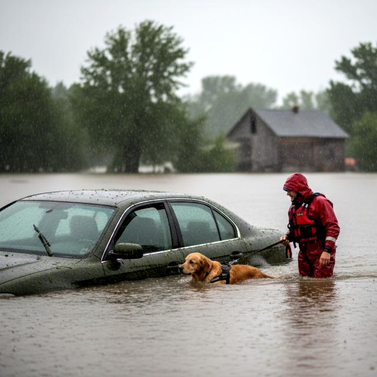<br>
<sub>Synthetic flood image generated with Gemini 2.5 Flash Image.</sub>
</div>

<details>
<summary>Example prompts</summary>

1. "Authentic documentary photo of a brown horse standing in a flooded street after heavy rain, realistic proportions, clear body visible, imperfect disaster photo"

2. "Documentary style photo of a white horse trapped in a pasture with floodwater, overcast sky, realistic proportions, authentic disaster scene"

3. "Low-resolution documentary photo of two wet cats stranded on a rooftop surrounded by floodwater, realistic proportions, visible faces, authentic urban flood event"

4. "Low quality documentary style photo of a stray dog on a small wooden raft during flood, rescue scene, realistic body intact"

5. "Documentary flood photo of cows standing in a partially submerged field, water up to their legs, cloudy sky, authentic proportions"

6. "Realistic low-resolution documentary photo of a cow isolated in floodwater reflecting sunset colors, authentic disaster photo"

</details>

[Synthetic image generation notebook](./notebooks/data-generation/generative-images-synthetic-gemini.ipynb)

## Annotations and models

Annotations were performed on the **Roboflow** platform. Both detector families are trained on the six classes below, with per-epoch validation. The separate YOLOv26m comparison uses the test split. Each experiment's artifacts — configuration, metrics and visualizations — are available in [`models/`](./models).

### Classes (Roboflow)

| Class | Description |
|--------|-----------|
| `civilian` | Person with insufficient visual evidence of a rescue role |
| `rescuer` | Person with visible evidence of a rescue role |
| `cat`, `dog` | Cats and dogs |
| `cow`, `horse` | Cattle and horses |

### Architectures

The project compares two complementary object-detection approaches:

- **YOLOv26** (Ultralytics): a single-stage detector. The trained variants are YOLOv26n (nano), YOLOv26s (small), YOLOv26m (medium) and YOLOv26l (large).
- **RF-DETR** (Roboflow): a Transformer-based detector. RF-DETR Nano and RF-DETR Medium were trained on the same dataset classes.

The app downloads the selected model weights from Hugging Face on first use and caches them locally.

### Training pipeline

1. **Preparation:** export Roboflow annotations and organize the project's six classes.
2. Train the YOLOv11, YOLOv26, and RF-DETR variants with their respective configurations.
3. **Continuous validation:** per-epoch metrics, loss curves and *overfitting* analysis.
4. Compare validation metrics and qualitative examples. Use the test split for the five-class comparison with COCO.

### Training environment

YOLOv26 was trained in Google Colab on an NVIDIA T4 GPU. RF-DETR Nano used MPS acceleration, and Medium used CUDA in Colab. Both RF-DETR runs were configured for 50 epochs and an effective batch size of 16 through gradient accumulation. Input resolutions were 384 px for Nano and 576 px for Medium.

This example starts YOLOv26 Nano training from the official pretrained weights.

```python
from ultralytics import YOLO

model = YOLO('yolo26n.pt')
model.train(
    data='dataset/data.yaml',
    epochs=50,
    imgsz=640,
    batch=16,
    name='yolov26n'
)
```

[YOLOv26 training notebook](./notebooks/training/training-yolo-dataset.ipynb) · [RF-DETR training notebook](./notebooks/training/training-rfdetr-dataset.ipynb)

## Metrics and results

The main model comparisons use the **six-class validation split**. For each run, the selected row is the one with the highest recorded validation mAP@0.5. The five-class COCO comparison below uses the test split and a separate protocol.

- [Saved model results](./models/comparisons/)
- [Evaluation package and reproduction commands](./src/evaluation/README.md)
- [Evaluation notebooks](./notebooks/README.md#workflow)

### YOLOv11 and YOLOv26

| Variant | YOLOv11 mAP@0.5 | YOLOv26 mAP@0.5 | YOLOv26 mAP@0.5:0.95 | YOLOv26 training time |
| --- | ---: | ---: | ---: | ---: |
| Nano | 0.8606 | 0.8267 | 0.4872 | 47.6 min |
| Small | 0.8755 | 0.8667 | 0.5024 | 56.3 min |
| Medium | 0.8642 | 0.8774 | 0.5154 | 108.4 min |
| Large | 0.8621 | 0.8919 | 0.5247 | 133.1 min |

YOLOv11 leads at Nano and Small sizes. YOLOv26 leads at Medium and Large sizes, with **YOLOv26l** recording the highest mAP@0.5 among the YOLO runs.

<div align="center">
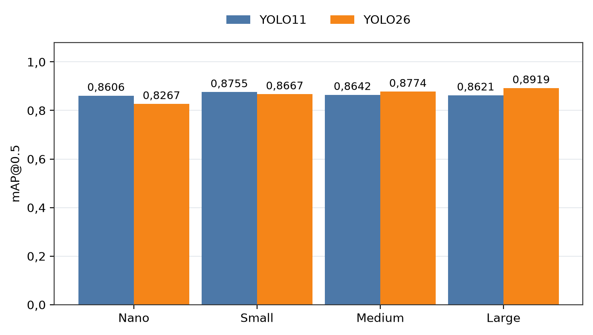
</div>

[YOLOv26 results by variant](./static/images/evaluation/yolo26-validation-map50.png) · [YOLOv11 validation curves](./static/images/evaluation/yolo11-validation-curves.png) · [YOLOv26 validation curves](./static/images/evaluation/yolo26-validation-curves.png)

The per-class chart comes from evaluating the selected checkpoints on the 383 validation images. `dog` generally had the lowest AP@0.5.

<div align="center">
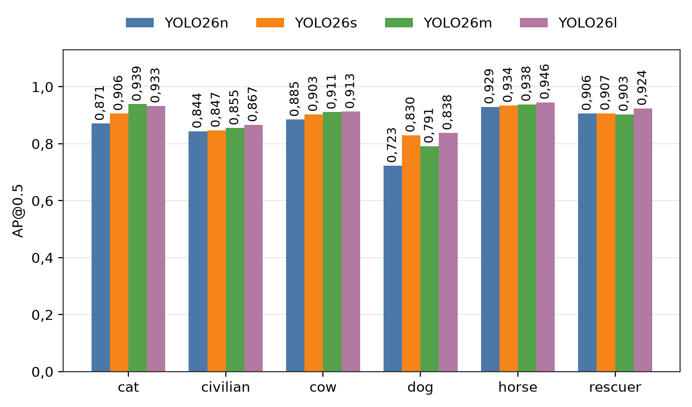
</div>

### RF-DETR and YOLOv26m

The RF-DETR logs preserve validation metrics for epochs 40–49. The table uses the highest available mAP@0.5 for each variant. YOLOv26m is included for comparison.

| Model | Epoch | Precision | Recall | mAP@0.5 | mAP@0.5:0.95 |
| --- | ---: | ---: | ---: | ---: | ---: |
| RF-DETR Nano | 40 | 0.9115 | 0.7787 | 0.8685 | 0.5182 |
| RF-DETR Medium | 43 | 0.9159 | 0.8661 | **0.9197** | **0.5590** |
| YOLOv26m | 35 | 0.8950 | 0.7924 | 0.8774 | 0.5154 |

RF-DETR Medium recorded the highest validation mAP@0.5 in the experiments. The two model families use different input resolutions and evaluation implementations, so these results describe the tested configurations. Within RF-DETR, the recorded F1 was 0.8366 for Nano and 0.8895 for Medium.

<div align="center">
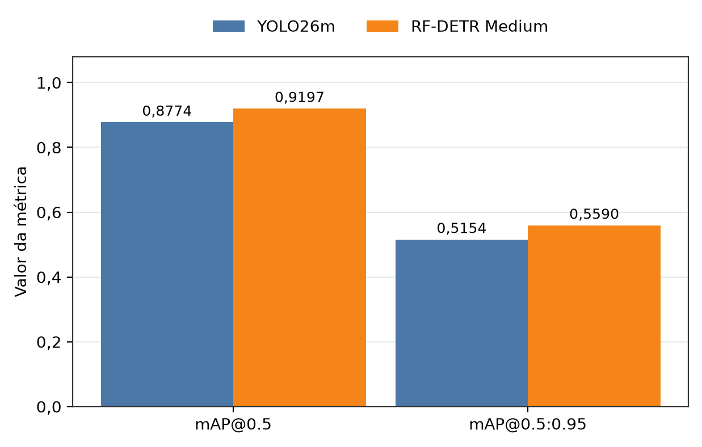
</div>

[RF-DETR global metrics](./static/images/evaluation/rfdetr-validation-metrics.png) · [RF-DETR AP@0.5:0.95 by class](./static/images/evaluation/rfdetr-validation-ap-by-class.png) · [RF-DETR validation curves](./static/images/evaluation/rfdetr-validation-curves.png) · [Medium variants: precision and recall](./static/images/evaluation/rfdetr-medium-vs-yolo26m-validation-precision-recall.png)

### Custom YOLOv26m vs. COCO on the test split

Both checkpoints were evaluated on the same **183 images and 702 annotations**. The five shared categories were `person`, `cat`, `dog`, `horse`, and `cow`. Civilian and rescuer annotations and predictions were combined into `person` before shared non-maximum suppression. Precision and recall are micro averages at confidence 0.25 and matching IoU 0.50.

| Metric | Custom YOLOv26m | COCO-pretrained YOLOv26m |
| --- | ---: | ---: |
| Micro precision | **0.803** | 0.765 |
| Micro recall | **0.808** | 0.718 |
| mAP@0.5 | **0.884** | 0.791 |
| mAP@0.5:0.95 | **0.542** | 0.413 |

<div align="center">
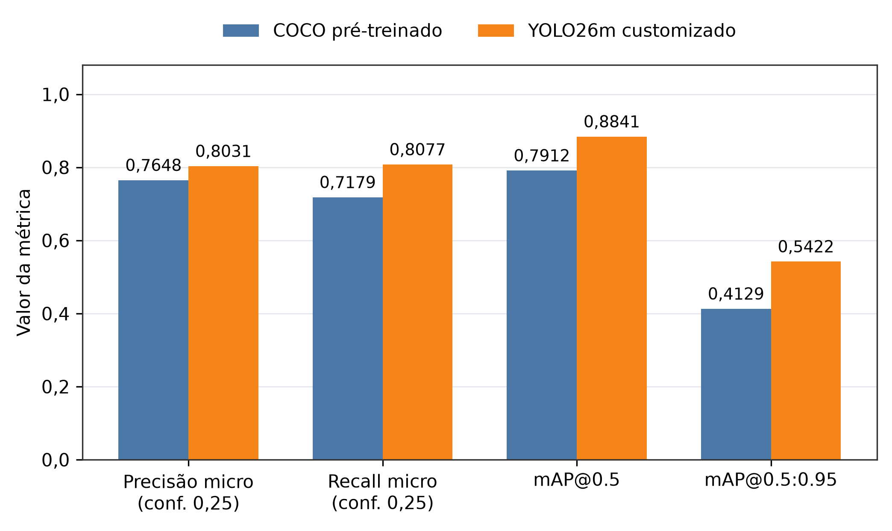
</div>

These results describe person and animal detection under the shared protocol. A later review found training copies of at least **14 of 183 test images** and **33 of 383 validation images**. This overlap can inflate scores and may favor the custom checkpoint. [Full test results](./models/comparisons/coco-vs-custom-yolo26m-common-test.json)

### Training duration and CPU inference

YOLOv26 training took **47.6–133.1 minutes** over 50 epochs. The saved RF-DETR logs contain no training duration. The CPU benchmark used ten validation images and three repeats per model after warmup. YOLOv26n had the lowest mean latency at **73.0 ms/image**, compared with **643.8 ms/image** for RF-DETR Medium. Measurements include preprocessing, network execution, and postprocessing. They exclude image and weight loading, warmup, and box drawing.

<div align="center">
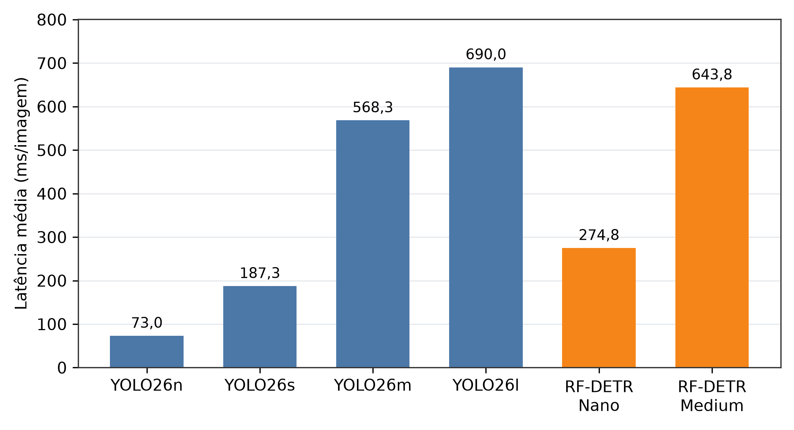
</div>

[YOLOv26 training duration chart](./static/images/evaluation/yolo26-training-duration.png) · [CPU benchmark samples](./models/comparisons/model-inference-times.json)

### Detection examples and rescue video

The validation mosaics show the same four images before and after inference using YOLOv26m at confidence 0.70. The boxes show model predictions.

<div align="center">
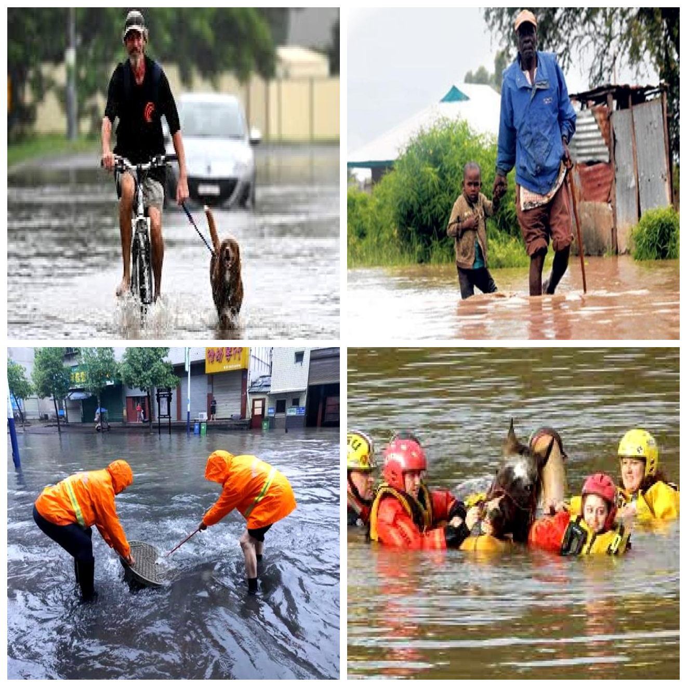
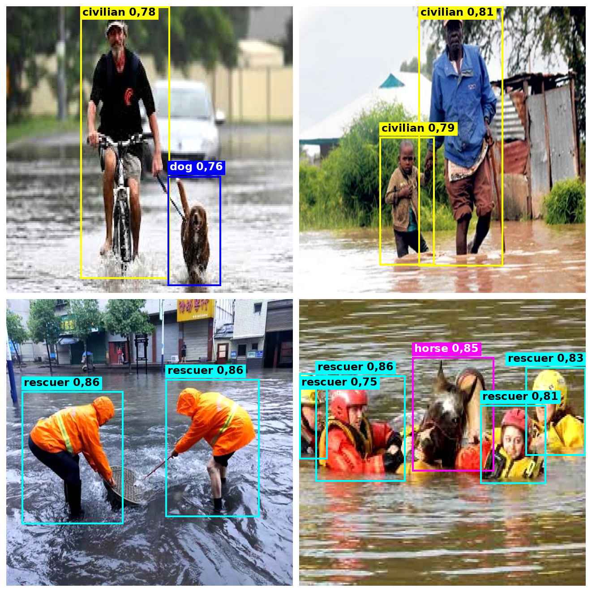
</div>

On an external flood image and a rescue video, YOLOv26m ran at confidence 0.25. The video had detections in **352 of 384 frames** on the first pass. Visual inspection found missed objects and rocks classified as animals. The examples have no ground-truth annotations, so the count describes how often the detector produced boxes.

<div align="center">
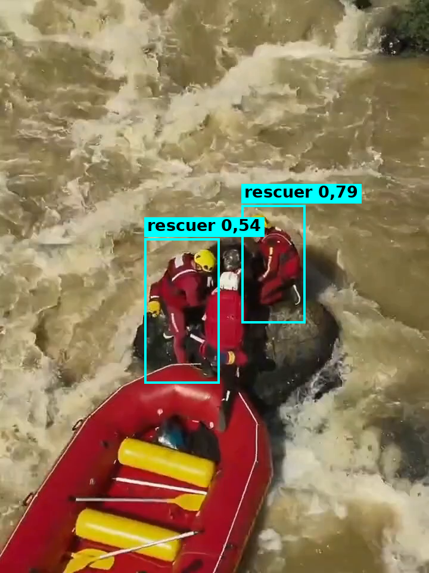
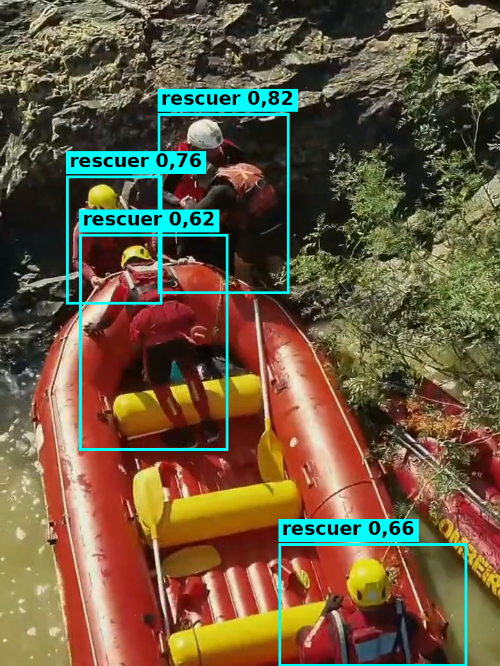
</div>

[Original external image](./static/images/qualitative/external-disaster.jpg) · [External image with predictions](./static/images/qualitative/external-image-detections.png) · [Source video from the Santa Catarina Military Fire Brigade](https://www.youtube.com/shorts/6PuaEPbOhJU) · [External inference measurements](./models/comparisons/external-inference.json) · [Media credits](./static/images/README.md)

## Conclusions and limitations

RF-DETR Medium had the highest recorded validation mAP@0.5, while YOLOv26n had the shortest mean prediction time in the local CPU benchmark. The same validation split was used to select epochs and compare the model families. The split overlap, the mix of real and synthetic images, and the absence of repeated training runs limit how far these results generalize.

### Future work

- Deduplicate by visual content and source image before creating new splits.
- Add more real images and a wider range of rescuer uniforms, then evaluate real and synthetic images separately.
- Repeat training with different seeds and measure end-to-end video performance and memory use on the target devices.

## Interactive Interface

The interface was built with **Gradio** to allow testing the trained models without setting up a training environment. You can upload images or videos and view detections (civilians, rescuers and animals) with _bounding boxes_ and labels after processing.

### Test online

The application is available on **Hugging Face Spaces**. No installation required to try it:

**👉 [Open Urban Disaster Monitor](https://huggingface.co/spaces/carolinasoares/urban-disaster-monitor-v2)**

<div align="center">
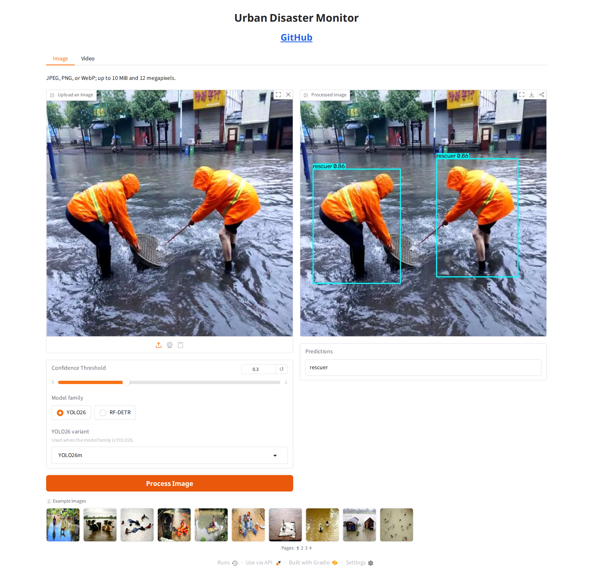
</div>

*Local interface screenshot with YOLOv26m and a confidence threshold of 0.30.*

### Controls and limits

- **Family and model:** choose YOLOv26 (n, s, m or l) or RF-DETR (Nano or Medium)
- Accepts JPEG, PNG, or WebP images up to 10 MiB and 12 megapixels.
- Accepts videos up to 50 MiB, 60 seconds, 1280×720 px (or 720×1280 px), 60 FPS, and 1,800 frames. By default, the app processes every frame. If you sample every second or third frame, skipped frames stay in the video without annotations.
- Adjust the confidence threshold to filter detections.
- View bounding boxes and labels and download the processed image or video.

### Technologies

[Python](https://www.python.org/) · [Gradio](https://gradio.app/) · [Ultralytics YOLO](https://docs.ultralytics.com) · [RF-DETR](https://github.com/roboflow/rf-detr) · [PyTorch](https://pytorch.org/) · [OpenCV](https://opencv.org/) · [NumPy](https://numpy.org/)

### Run locally

The app was verified with Python 3.12. An internet connection is needed to download the model weights on first use.

```bash
git clone https://github.com/MariaCarolinass/urban-disaster-monitor.git
cd urban-disaster-monitor
```

On Linux or macOS, create and activate the virtual environment.

```bash
python3 -m venv .venv
source .venv/bin/activate
```

On Windows PowerShell, use these commands.

```powershell
py -3.12 -m venv .venv
.venv\Scripts\Activate.ps1
```

From the repository root, install the app dependencies and launch the interface. Open the local URL shown in the terminal.

```bash
python -m pip install -r app/requirements.txt
python app/app.py
```

To run experiments, install the additional dependencies in the [notebook guide](./notebooks/README.md#local-setup).

## Team

| [](https://github.com/jagaldino) | [](https://github.com/MariaCarolinass) |
| :---------------------------------------------------------------------------: | :-----------------------------------------------------------------------------: |
|                           **João Galdino**                           |                             **Carolina Soares**                | 

## License

- The project code uses the [MIT License](./LICENSE.txt).
- The published dataset is marked [CC BY 4.0](https://creativecommons.org/licenses/by/4.0/). See the [dataset attribution](./dataset/SOURCES.md) and [demo media credits](./static/images/README.md).

## References

### Models and evaluation

- Redmon, J., Divvala, S., Girshick, R., & Farhadi, A. (2016). [You Only Look Once: Unified, Real-Time Object Detection](https://arxiv.org/abs/1506.02640). CVPR, 779–788.
- Carion, N., et al. (2020). [End-to-End Object Detection with Transformers](https://www.ecva.net/papers/eccv_2020/papers_ECCV/html/832_ECCV_2020_paper.php). ECCV, 213–229.
- Ultralytics. (2024). [YOLO11 release in Ultralytics v8.3.0](https://github.com/ultralytics/ultralytics/releases/tag/v8.3.0).
- Jocher, G., et al. (2026). [Ultralytics YOLO26: Unified Real-Time End-to-End Vision Models](https://arxiv.org/abs/2606.03748). arXiv:2606.03748.
- Robinson, I., Robicheaux, P., Popov, M., Ramanan, D., & Peri, N. (2026). [RF-DETR: Neural Architecture Search for Real-Time Detection Transformers](https://proceedings.iclr.cc/paper_files/paper/2026/hash/5bed8703db85ab27dc32f6a42f8fbdb6-Abstract-Conference.html). ICLR.
- Padilla, R., Passos, W. L., Dias, T. L. B., Netto, S. L., & da Silva, E. A. B. (2021). [A Comparative Analysis of Object Detection Metrics with a Companion Open-Source Toolkit](https://www.mdpi.com/2079-9292/10/3/279). *Electronics*, 10(3), 279.

### Datasets and tools

- Lin, T.-Y., et al. (2014). [Microsoft COCO: Common Objects in Context](https://link.springer.com/chapter/10.1007/978-3-319-10602-1_48). ECCV, 740–755.
- Rahnemoonfar, M., et al. (2021). [FloodNet: A High Resolution Aerial Imagery Dataset for Post Flood Scene Understanding](https://arxiv.org/abs/2012.02951). *IEEE Access*, 9, 89644–89654.
- Torralba, A., & Efros, A. A. (2011). [Unbiased Look at Dataset Bias](https://people.csail.mit.edu/torralba/research/bias/). CVPR, 1521–1528.
- UFRNProjects. [Urban Disaster Monitor dataset on Roboflow Universe](https://universe.roboflow.com/ufrnprojects-xlut9/urban-disaster-monitor).
- Google. (2025). [Gemini 2.5 Flash Image announcement](https://developers.googleblog.com/introducing-gemini-2-5-flash-image/).

### Related work on flooding and disaster response

- Prabhu, B. V. B., Lakshmi, R., Ankitha, R., Prateeksha, M. S., & Priya, N. C. (2022). [RescueNet: YOLO-based object detection model for detection and counting of flood survivors](https://doi.org/10.1007/s40808-022-01414-6). *Modeling Earth Systems and Environment*, 8(4), 4509–4516.
- Pattankudi, M. S. Z., et al. (2025). [Human Detection in Disaster Scenarios for Enhanced Emergency Response Using YOLO11](https://www.scitepress.org/PublishedPapers/2025/136010/). INCOFT, 2, 739–746.
- Vibhuti, S. S., et al. (2025). [YOLO11: Flood Victim Detection and Rescue Alert System](https://www.scitepress.org/PublishedPapers/2025/136030/). INCOFT, 2, 804–811.
- Sai, D. H., et al. (2025). [Enhancing Emergency Response with Real-Time Video Analytics for Natural Disaster Management](https://ieeexplore.ieee.org/abstract/document/11018905). STCR.
